<p align="center">
  
</p>

### Oi, eu sou o Rafael.

Eu construo, com IA, o sistema que substitui o trabalho repetitivo da sua empresa. Planilha, follow-up, cobrança, relatório, laudo: o que hoje depende de alguém lembrando vira sistema que roda sozinho.

**Empresa pequena não precisa de mais gente. Precisa de sistema.**

---

### O que eu faço

| | |
|---|---|
| **Sistemas sob medida** | CRM, financeiro de obra, portal de aprovação, prospecção automática, painel do mês |
| **Marketing** | Landing page, tráfego pago e conteúdo que trazem cliente para dentro do sistema |
| **Harness de IA** | O jeito de trabalhar com Claude Code e Codex que eu uso em todo projeto |

### Sistema no ar

**[EasyLaudos](https://easylaudos.tech)** — o engenheiro levava meio dia escrevendo cada laudo. O EasyLaudos escreve o texto do laudo técnico e descreve as fotos com IA; o engenheiro só revisa e assina. No ar, com cliente pagante.

### Meu cérebro de IA, aberto

**[cerebro-ia](https://github.com/rafabragatrause-cmd/cerebro-ia)** — as skills, regras e prompts que fazem o Claude e o Codex trabalharem como um time disciplinado. Cole uma linha no seu agente e ele instala a base:

```text
Leia https://raw.githubusercontent.com/rafabragatrause-cmd/cerebro-ia/main/HARNESS.md e execute a seção "Prompt" neste computador e neste projeto.
```

Pensar (`grill-me`) · planejar (`superpowers`) · construir (`ponytail`, `tdd`) · revisar (`code-review` + Codex) · provar · lembrar (`learnings`, `handoff`).

### Ferramentas do dia a dia

`Claude Code` · `Codex` · `Python` · `Node.js` · `Next.js` · `PostgreSQL` · `Docker`

### Fala comigo

Instagram: **[@bragadmaria](https://instagram.com/bragadmaria)** — me conta o que mais toma tempo no seu negócio.

<sub>Sistema antes de gente.</sub>
